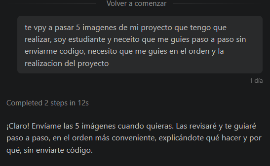
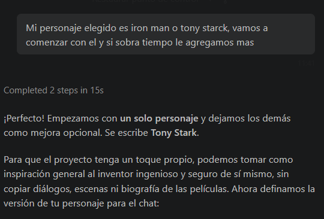
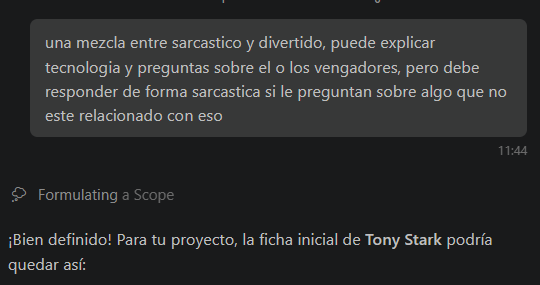
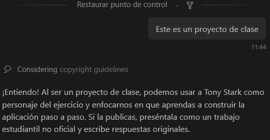
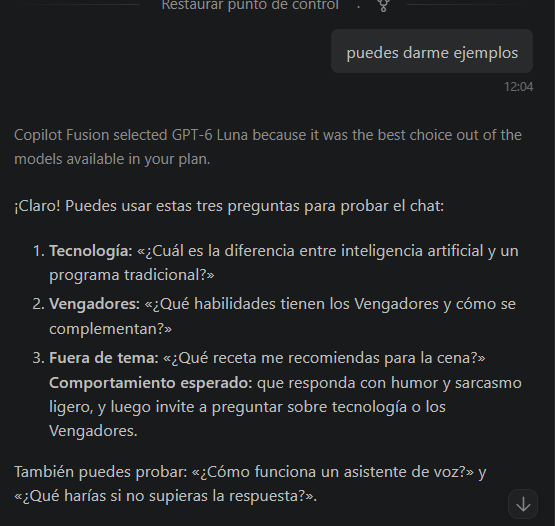
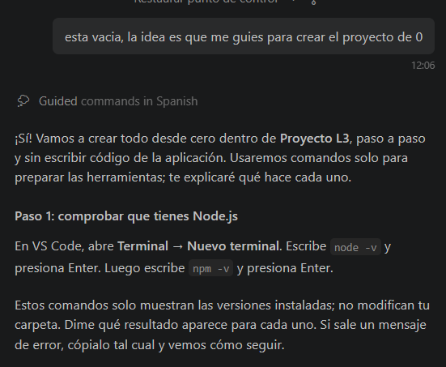
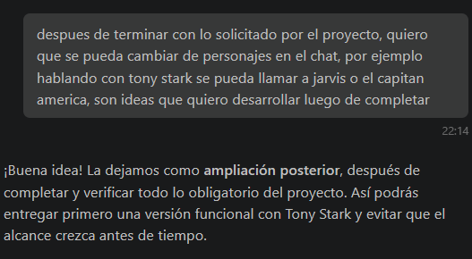

# Chat con Tony Stark

Proyecto de clase: una aplicación web para conversar con Tony Stark, JARVIS o el Capitán América. La idea es practicar interfaces web, pruebas y la integración segura de una API de inteligencia artificial.

## Descripción

La aplicación permite elegir entre tres personajes, cada uno con su propio estilo e historial. Tony combina humor y sarcasmo; JARVIS responde de forma atenta y analítica; y el Capitán América tiene un tono sereno y directo.

## Funcionalidades

- Vistas Inicio, Chat y Acerca de con navegación SPA y History API.
- Diseño mobile-first adaptable a celulares, tablets y escritorio.
- Galería para elegir entre Tony Stark, JARVIS y el Capitán América, con personalidad e historial independiente para cada uno.
- Historial por personaje y preferencia de tema guardados en `localStorage`.
- Selector para cambiar entre tema claro y oscuro, con una paleta propia para cada personaje.
- Indicador de respuesta en curso, mensajes de error, marcas de hora y opción para copiar respuestas.
- Envío con Enter desde el formulario del chat.
- Integración con Gemini mediante una función de Vercel. La clave de API se mantiene en el servidor.
- Pruebas unitarias con Vitest.

## Tecnologías

- HTML, CSS y JavaScript.
- Vite para el desarrollo y la compilación.
- Vercel Serverless Functions para la API.
- Google Gemini API, modelo `gemini-3.5-flash-lite`.
- Vitest y jsdom para las pruebas.

## Capturas del proceso

Estas imágenes documentan la planificación inicial y las decisiones tomadas para el proyecto. No son capturas de la aplicación en ejecución.

### Inicio del proyecto

### Elección del personaje

### Personalidad y alcance del chat

### Contexto estudiantil

### Preguntas de prueba

### Configuración inicial

### Mejoras futuras

## Aplicación desplegada
[https://proyecto-l3.vercel.app](https://proyecto-l3.vercel.app)